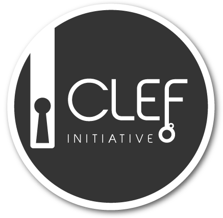
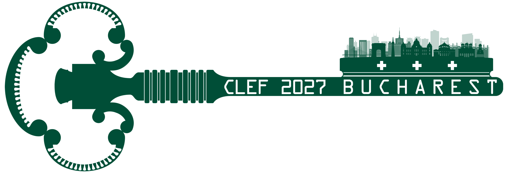

# CLEF 2027 SimpleText Track



  

## Simplify Scientific Text (and Nothing More)

Objective scientific information helps any user navigate a world where misinformation, disinformation, or unfounded generated information is only a single mouse click away. Everyone acknowledges the importance of objective scientific information, but the general public seldom consults scientific sources. For example, biomedical research can directly impact people's decisions about health. However, the most reliable and up-to-date sources in biomedicine contain complex language and assume a high degree of background knowledge, making them difficult for the general public to understand.

While significant progress has been made in enhancing accessibility through LLMs, challenges like balancing simplicity with accuracy, dense technical terminology, maintaining logical flow, and adapting to varied audiences remain challenging. Moreover, LLMs can unintentionally introduce misinformation, distort meanings, or create content that deviates from the original text.

The main goal of the CLEF 2027 SimpleText track is to advance the field of natural language processing by addressing key challenges in simplifying complex scientific texts, ensuring the reliability and accuracy of generated content, and refining popular tasks from previous editions. To ensure the transition to the new track setup, we will revisit and rerun some of the earlier tasks by popular demand.
 
## [Tasks](./tasks)

- [Task 1](./tasks): Text Simplification: Simplify scientific text
  - Task 1.1 - Sentence-level Scientific Text Simplification
  - Task 1.2 - Document-level Scientific Text Simplification 
  - Task 1.3 - Section-level Scientific Text Simplification
  - Task 1.4 - Multilingual Scientific Text Simplification

- [Task 2](./tasks): Controlled Creativity: Identify and Avoid Hallucination
  - Task 2.1 - Identify Creative Generation at Document Level
  - Task 2.2 - Detect and Classify Information Distortion Errors in Simplified Sentences
  - Task 2.3 - Avoid Creative Generation and Perform Grounded Generation by Design
- [Task 3](./tasks): Scientific Sycophancy: Detect Sycophancy in Scientific Question Answering
  - Task 3 is a new task that asks whether a model's answer to a scientific question (climate change and health) is sycophantic or non-sycophantic.
- [Task 4](./tasks): SOTA-IR: Tracking the State of the Art in Information Retrieval from Text and Tables
  - Extract every result reported in an information retrieval paper as a (Task, Dataset, Metric, Score) tuple, and say whether each model was proposed by the authors or used as a baseline.
- [Task 5](./tasks): SimpleText Revisited
  - We encourage revisiting tasks from earlier years of the CLEF SimpleText Track.
  - The [Codabench of CLEF 2026 SimpleText Task 1](https://www.codabench.org/competitions/16108/) and the [Codabench of CLEF 2026 SimpleText Task 2](https://www.codabench.org/competitions/16065/) are still operational, and participants are invited to report on experiments on all tasks from earlier years in their CLEF 2027 paper submissions. 
 

## How to participate

The registration link to participate will open soon. The registration dates will be announced on the [CLEF 2027](https://clef2027.clef-initiative.eu/) website.

All team members should join the SimpleText mailing list:
[https://groups.google.com/g/simpletext](https://groups.google.com/g/simpletext). 

The data will be made available to all registered participants.

## Acknowledgement  

SimpleText is supported by the French research network on Big Data - Data Science [MADICS](https://www.madics.fr/). This research was funded, in whole or in part, by the French National Research Agency (ANR) under the project [ANR-22-CE23-0019-01](https://anr.fr/Project-ANR-22-CE23-0019). 

## References  
* Reference to the 2027 paper will follow shortly
* Ermakova, L., Azarbonyad, H., Bakker, J., Vendeville, B., Kamps, J. (2026). CLEF 2026 SimpleText Track. In: Hauff, C., et al. Advances in Information Retrieval. ECIR 2026. Lecture Notes in Computer Science, vol 15576. Springer, Cham. [https://doi.org/10.1007/978-3-031-88720-8_63](https://doi.org/10.1007/978-3-031-88720-8_63)

---

 
 
 
 

